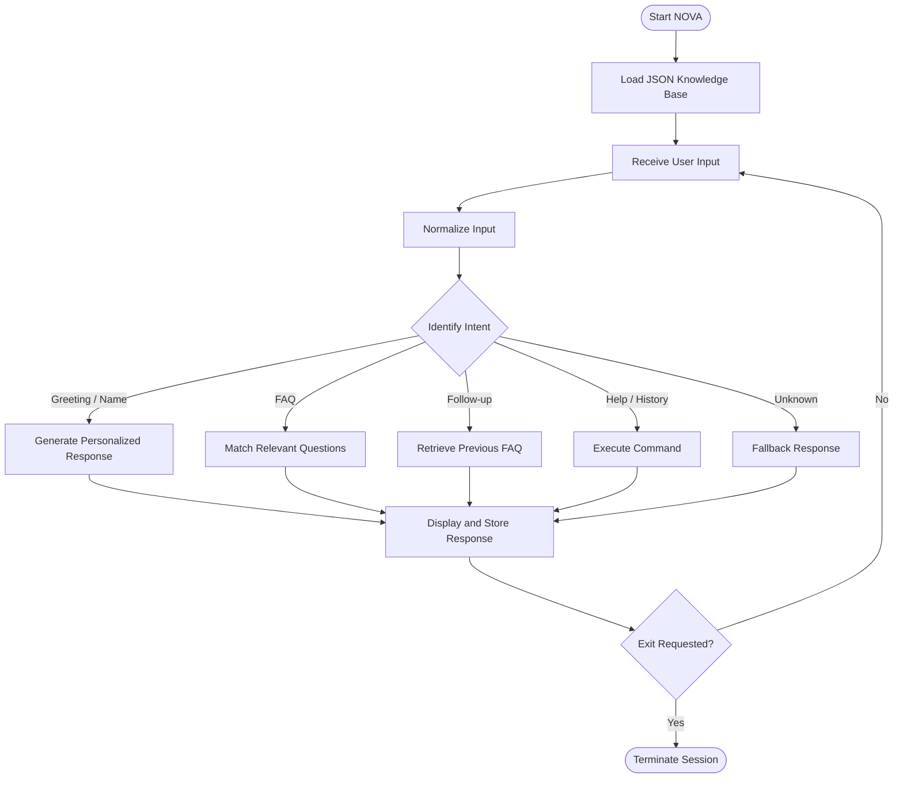

# ◈ NOVA — Intelligent Terminal Assistant

### A Rule-Based Conversational Assistant Built with Python

<p align="center">
  <strong>Understand. Respond. Remember.</strong>
</p>

<p align="center">
  
  
  
  
</p>

---

## ◈ Overview

**NOVA** is an interactive, rule-based terminal assistant developed using Python. It is designed to simulate a simple customer-support conversation by identifying user intents, processing natural-language input, and delivering relevant responses.

Powered by **regular expressions, keyword matching, JSON-based knowledge storage, and conversational state management**, NOVA can recognize greetings, answer frequently asked questions, remember basic user context, and maintain conversation history throughout a session.

The project demonstrates how structured logic and lightweight text processing can be combined to create a functional conversational interface — without relying on external AI APIs or machine-learning models.

## ✦ Core Capabilities

| Capability | Description |
|---|---|
| Intent Recognition | Identifies user queries using keywords and regular expressions |
| Multi-Intent Handling | Responds to multiple recognized FAQ topics in one message |
| Personalization | Recognizes and remembers the user's name during a session |
| Context Awareness | Understands supported follow-up commands |
| Knowledge Base | Loads FAQ content dynamically from a JSON file |
| Conversation History | Records and displays interactions from the current session |
| Error Handling | Handles missing or invalid knowledge-base data |
| Graceful Exit | Supports multiple exit commands |

## ◈ See NOVA in Action

```text
=======================================================
              NOVA TERMINAL ASSISTANT
=======================================================
Hello! I am NOVA, your Datheon support assistant.
I can answer internship-related questions and FAQs.

Available Commands:
  help     - Show available commands
  history  - View conversation history
  bye      - Exit the assistant
=======================================================

You: hello

NOVA: Hello! How can I assist you today?

You: how do I submit my internship project?

NOVA: Q: How do I submit my internship project?
A: You can submit your public GitHub repository
   link through your Student Workspace.

You: tell me more

NOVA: You can submit your public GitHub repository
link through your Student Workspace.

You: bye

NOVA: Thank you for chatting with NOVA. Have a great day!
```

*Illustrative terminal session showing the implemented features.*

## ⚙️ How It Works

NOVA follows a structured conversational workflow:



### Processing Pipeline

1. **Input Processing** — Converts user input into lowercase, normalized text.
2. **Intent Detection** — Uses regular expressions and keyword matching to identify relevant intents.
3. **Knowledge Retrieval** — Compares recognized keywords against FAQ entries stored in JSON.
4. **Response Generation** — Constructs responses based on the identified intent.
5. **Context Management** — Retains the user's name and previous FAQ for supported follow-ups.
6. **History Management** — Stores interactions during the active session.

## 🛠️ Technology Stack

| Technology | Purpose |
|---|---|
| Python 3 | Core programming language |
| `re` | Pattern matching and intent recognition |
| `json` | External FAQ knowledge storage |
| `pathlib` | Reliable knowledge-base file path handling |

**Architecture:** Object-oriented, rule-based conversational system.

**External dependencies:** None.

## 📁 Project Structure

```text
task4_chatbot/
│
├── chatbot.py          # Main chatbot application
├── sample_faq.json     # FAQ knowledge base
└── README.md           # Project documentation
```

### Knowledge Base Design

NOVA separates its conversational logic from its stored information.

The `sample_faq.json` file contains two main sections:

- `greetings` — Supported greeting phrases.
- `faqs` — Question-and-answer entries used by the chatbot.

This separation makes the knowledge base easier to maintain and extend.

## 🚀 Getting Started

### Prerequisites

- Python 3.x
- Visual Studio Code or any Python-compatible editor
- Terminal or command-line interface

### 1. Clone the Repository

```bash
git clone <your-repository-url>
```

### 2. Navigate to the Project

```bash
cd task4_chatbot
```

### 3. Run NOVA

```bash
python chatbot.py
```

NOVA will initialize its knowledge base and launch the interactive terminal session.

## ⌨️ Supported Commands

| Input | Action |
|---|---|
| `hello` | Initiates a greeting |
| `my name is Harsha` | Stores the user's name |
| `help` | Displays available assistance |
| `history` | Displays conversation history |
| `tell me more` | Repeats the previous FAQ answer |
| `repeat` | Repeats the previous FAQ answer |
| `bye` | Ends the session |
| `exit` | Ends the session |
| `quit` | Ends the session |

## 🧪 Testing & Validation

NOVA was manually evaluated using nine test scenarios covering its major functionality.

| # | Test Scenario | Result |
|---:|---|---|
| 01 | Greeting recognition | PASS |
| 02 | Name recognition | PASS |
| 03 | Greeting + FAQ combination | PASS |
| 04 | Multi-intent recognition | PASS |
| 05 | Project submission FAQ | PASS |
| 06 | Context-aware follow-up | PASS |
| 07 | Conversation history | PASS |
| 08 | Unknown query fallback | PASS |
| 09 | Graceful exit | PASS |

<p align="center">
  <strong>9 / 9 Manual Test Scenarios Passed</strong>
</p>

## 🔮 Future Improvements

Potential extensions for future versions include:

- Expanded FAQ categories and configurable responses.
- Improved intent matching and typo tolerance.
- Persistent conversation history across sessions.
- Additional conversational commands.
- A graphical user interface.
- Integration with external support systems.

## 🎓 Internship Project

**Program:** Python Programming Internship  
**Organization:** Datheon  
**Project:** Pro Task 4 — Rule-Based Interactive Terminal Assistant

## 👨‍💻 Author

**Harsha Vardhan V G**

Interested in Python development, cybersecurity, automation, and building practical software solutions.

---

<p align="center">
  <strong>◈ NOVA</strong><br/>
  <sub>A small step toward smarter interactive systems.</sub>
</p>